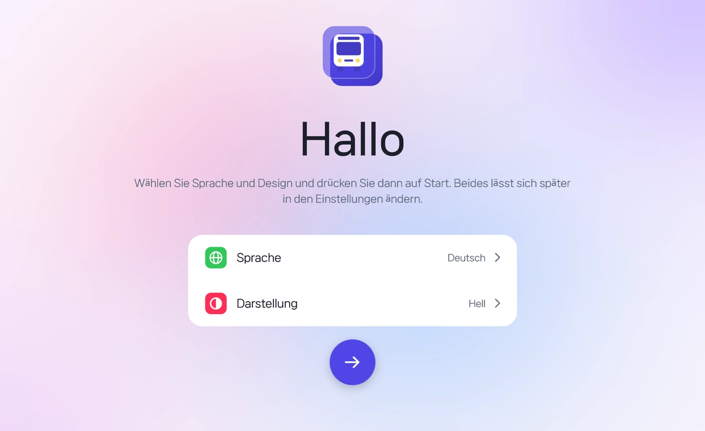

<p align="center">
  
</p>

<h1 align="center">Bus Depot</h1>

<p align="center">
  Ein Werkzeug für OMSI 2, das <b>obj → x → o3d</b> aus Blender ordnerweise in einem Rutsch konvertiert<br>und außerdem OMSI-Objekte und Splines erstellt, Busse (.bus) prüft und bearbeitet und Karten untersucht
</p>

<p align="center">
  <a href="https://github.com/HYB1022/obj2x/releases/latest"></a>
  <a href="https://github.com/HYB1022/obj2x/releases"></a>
  
  <a href="LICENSE"></a>
</p>

<p align="center">
  <a href="https://github.com/HYB1022/obj2x/releases/latest/download/BusDepot.zip"><b>⬇ BusDepot.zip herunterladen</b></a>
  &nbsp;·&nbsp;
  <a href="#verwendung">Verwendung</a>
  &nbsp;·&nbsp;
  <a href="#fehlerbehebung">Fehlerbehebung</a>
</p>

<p align="center">
  <a href="README.md">한국어</a> · <a href="README.en.md">English</a> · <b>Deutsch</b> · <a href="README.ja.md">日本語</a> · <a href="README.zh.md">中文</a>
</p>

<p align="center">
  <picture>
    <source media="(prefers-color-scheme: dark)" srcset="docs/images/de/welcome-dark.webp">
    
  </picture>
</p>

> [!NOTE]
> **Seit v2.7.3 heißt obj2x jetzt Bus Depot.** Das Programm ist `BusDepot.exe`, die Einstellungen liegen in `BusDepot.ini`. Alte Einstellungen (`obj2x.ini`) werden beim ersten Start übernommen, und ältere Versionen aktualisieren sich weiterhin automatisch. Übrig gebliebene alte Dateien werden aufgeräumt; der Starter `obj2x.exe` bleibt, damit alte Verknüpfungen funktionieren.

Statt Dateien einzeln zu öffnen, Optionen einzustellen und Convert zu drücken, **wählst du nur einen Ordner**, den Rest erledigt das Programm.

- **Stapelkonvertierung**: konvertiert alle `.obj` eines Ordners mit Blender 2.79b zu `.x` und anschließend mit OmsiXConv zu `.o3d`. Die Kontrollkästchen von OmsiXConv (`X-File: z up` usw.) werden wie festgelegt gesetzt.
- **Parallele Verarbeitung**: startet mehrere OmsiXConv gleichzeitig und schiebt deren Fenster aus dem Bildschirm, sodass nur das Fenster dieses Werkzeugs zu sehen ist.
- **Schnellkonvertierung (experimentell)**: erzeugt `.o3d` direkt aus obj, ohne Blender und OmsiXConv, in etwa 0,1 s pro Datei.
- **Ergebnistabelle**: Vertices, Dreiecke, Materialien, Dauer und Status (OK / Warnung / Fehler) je Datei auf einen Blick.
- **OMSI-Erstellung**: erstellt Szenerieobjekte (`.sco`) aus o3d-Modellen und Straßensplines (`.sli`) aus Spur- und Gehwegwerten direkt im OMSI-Ordner.
- **Bus**: öffnet eine `.bus` und zeigt das Modell mit Lackierung in 3D, spielt die Animationen (`[newanim]`) ab, korrigiert Drehpunkte, Drehungen und Faktoren und bearbeitet Fahrgastwege (`paths.cfg`) und Sitze (`passengercabin.cfg`). Auch als Blender-Datei (`.blend`) oder OBJ speicherbar.
- **Karte**: zeigt Karteninfos und die Lage von Kacheln, Splines und Objekten und findet fehlende Objekte, Splines, KI-Fahrzeuge und Personen. HOF-Dateien lassen sich ebenfalls ansehen.

Die `.o3d` entsteht im selben Ordner wie die `.x` und heißt wie die obj (`face.obj` → `face.x` → `face.o3d`).

## Bildschirme

<table>
  <tr>
    <td width="50%"></td>
    <td width="50%"></td>
  </tr>
  <tr>
    <td align="center"><b>Übersicht</b><br><sub>Vertices, Dreiecke, Materialien und Status je Datei in einer Ergebnistabelle</sub></td>
    <td align="center"><b>Konvertierungsassistent</b><br><sub>Art → Pfade → Optionen → fertig, in vier Schritten zur Konvertierung</sub></td>
  </tr>
  <tr>
    <td width="50%"></td>
    <td width="50%"></td>
  </tr>
  <tr>
    <td align="center"><b>Update-Hinweis</b><br><sub>Eine neue Version erscheint im Menü <code>Info</code> und wird mit einem Klick installiert</sub></td>
    <td align="center"><b>Dunkles Design</b><br><sub>In den <code>Einstellungen</code> wählst du Design (System / Hell / Dunkel), Akzentfarbe (Indigo / Petrol / Rosé), Sprache (한국어 / English / Deutsch / 日本語 / 中文) und Schrift</sub></td>
  </tr>
</table>

## Voraussetzungen

| Voraussetzung | Hinweis |
| --- | --- |
| Windows 10 / 11 | Das benötigte .NET Framework 4.x ist in Windows enthalten |
| [Blender 2.79b](https://download.blender.org/release/Blender2.79/) | Das mitgelieferte Add-on `Import-Export: DirectX X Format` muss aktiviert sein. Andere Versionen (2.8 und neuer) werden für die Konvertierung nicht unterstützt |
| OmsiXConv (Omsi X to O3D Converter 1.0) | **Nicht in diesem Repository enthalten.** Separat besorgen und den Ort von `OmsiXConv.exe` angeben |

Mit welchem Blender du modellierst, ist egal; 2.79b wird nur für die Konvertierung gebraucht. Wenn du nur die Schnellkonvertierung nutzt, brauchst du weder Blender noch OmsiXConv.

## Verwendung

1. Lade die neueste `BusDepot.zip` von den [Releases](https://github.com/HYB1022/obj2x/releases/latest) herunter und entpacke sie in einen **beschreibbaren Ordner**. Die Einstellungen werden in `BusDepot.ini` im selben Ordner gespeichert.
2. Starte `BusDepot.exe` (oder `BusDepot.bat`). Beim ersten Start musst du dem Haftungsausschluss zustimmen.
3. Gib im Tab `Erweitert` den Ort von `blender.exe` (Blender 2.79) und `OmsiXConv.exe` an. Er wird gespeichert.
4. Wähle im `Assistent` die Art, gib den OBJ-Ordner (Eingabe) und den Ausgabeordner an und starte. Ziehst du einen obj-Ordner (oder eine obj-Datei) auf das Fenster oder auf das Symbol von `BusDepot.exe`, öffnet sich der Assistent mit diesem Ordner; zuletzt verwendete Ordner lassen sich mit einem Klick wählen.
5. Der Fortschritt erscheint im Fortschrittsbalken und in den Tabs `Protokoll` / `Ergebnistabelle` der `Übersicht` sowie auf der Taskleistenschaltfläche von Bus Depot. Endet eine Konvertierung, während du in einem anderen Fenster bist, blinkt die Schaltfläche.

| Art | Was passiert |
| --- | --- |
| **DirectX → O3D** (empfohlen) | Der Standardweg: `.x` mit Blender 2.79b, dann `.o3d` mit OmsiXConv |
| **Nur Blender .x** | Erzeugt nur `.x`, ohne OmsiXConv |
| **FastO3D** (experimentell) | Der eingebaute Konverter erzeugt `.o3d` direkt aus obj. Bitte zuerst [Schnellkonvertierung](#schnellkonvertierung-experimentell) lesen |

> [!NOTE]
> Während OmsiXConv konvertiert, empfangen seine versteckten Fenster Eingaben. Bitte Maus und Tastatur möglichst nicht benutzen.

## Funktionen

| Funktion | Beschreibung |
| --- | --- |
| Unterordner einbeziehen | Konvertiert auch obj in Unterordnern. Die Ausgabe bekommt dieselbe Ordnerstruktur für `.x`/`.o3d` |
| Nur geänderte obj | Konvertiert nur obj, die neuer als ihre `.o3d` sind (bei nur `.x` wird mit `.x` verglichen). Praktisch beim wiederholten Exportieren |
| Stopp | Beendet Blender und alle OmsiXConv und leert die Warteschlange |
| Fehlgeschlagene wiederholen | Fehlgeschlagene Dateien stehen danach in der `Ergebnistabelle`, `Fehlgeschlagene wiederholen` startet nur diese neu. Dateien mit fertiger `.x` beginnen beim O3D-Schritt, in Blender oder der Schnellkonvertierung gescheiterte von vorn |
| Warnung bei fehlenden Texturen | Prüft vor der Konvertierung, ob die in der `.mtl` genannten Texturen vorhanden sind, listet fehlende auf und fragt, ob fortgefahren werden soll |
| Parallele Anzahl | Wie viele OmsiXConv gleichzeitig laufen. Standard ist die Anzahl logischer Kerne − 1. OmsiXConv nutzt einen Kern, mehr als Kerne vorhanden sind macht es nur langsamer |
| Update-Prüfung | Prüft beim Start die neueste Version auf GitHub und zeigt im Menü `Info` eine `Update`-Markierung |

### Tabs Erweitert / Einstellungen

- **OmsiXConv-Optionen** (`Erweitert`): `z up`, `Separate Files`, `Show Details of X`, `Remove Specular`, `Opt. Materials`, `Opt. Vertices`, `All Normals Up`, `Use Submesh Local Pos. as Global Pos.` werden bei jeder Konvertierung so gesetzt. Standard: `z up` aus, `Remove Specular` / `Opt. Materials` / `Opt. Vertices` an.
- **Zusätzliche Blender-.x-Exportoptionen** (`Erweitert`): pro Zeile `Name=Wert` für das Export-Add-on (z. B. `ApplyModifiers=True`). Angewendet werden nur Namen, die im Protokoll unter `x exporter options:` stehen; unbekannte erscheinen als `ignored options`.
- **.x bei Erfolg löschen** (`Einstellungen`): löscht die Zwischendatei `.x` nach erfolgreicher O3D-Konvertierung.
- **Schrift** (`Einstellungen`): NanumSquare Neo (Standard), Noto Sans KR, MiSans oder die Windows-Systemschrift. NanumSquare Neo und Noto Sans KR liegen im Ordner `fonts`. MiSans darf laut Lizenz nicht mitgeliefert werden; lade sie von [Xiaomis HyperOS-Schriftseite](https://hyperos.mi.com/font) und installiere sie in Windows oder lege sie in den Ordner `fonts`. Ohne sie wird NanumSquare Neo verwendet.
- **Sprachdateien** (`Einstellungen`): 한국어, English, Deutsch, 日本語 und 中文 sind eingebaut. Die Schaltfläche `Sprachdateien` legt neben der exe einen Ordner `lang` mit einer Übersetzungsvorlage (`_template.json`) an. Kopiere die Vorlage als `<Sprachcode>.json` (z. B. `fr.json`), übersetze sie, und sie erscheint in der Sprachliste. Unter dem Namen einer eingebauten Sprache gespeichert, ändert sie nur einzelne Texte.

## OMSI-Erstellung: Objekte / Splines / Bus / Karte

Der OMSI-2-Ordner wird automatisch über die Steam-Installation gefunden. Falls nicht, klicke auf einer dieser Seiten auf die Zeile `OMSI-2-Ordner` und wähle den Ordner mit `Omsi.exe`.

- **Objekt erstellen**: Wähle einen Ordner mit o3d-Modellen (oder ziehe ihn auf das Fenster), um eine Modellliste zu bekommen. `Erstellen` legt `model\`, `texture\` und die `.sco` in `Sceneryobjects\<Ordnername>` an; sie erscheinen in der Objektliste des Karteneditors.
  - Ein Objekt pro Modell oder alle Modelle in einem Objekt.
  - Kollision, begehbare Fläche (Brücken, Bahnsteige), Schatten und fest lassen sich ein- und ausschalten.
  - Texturen mit Alphakanal (tga/dds/png) bekommen automatisch ein transparentes Material (`[matl_alpha]`): ausschneiden (Blätter, Zäune) oder durchscheinend (Glas).
  - Texturen werden im Modellordner, daneben und in `texture`-Ordnern gesucht und kopiert. Nicht gefundene werden am Ende aufgelistet.
  - **.sco öffnen**: Wähle die `.sco` eines vorhandenen Objekts (oder ziehe sie auf das Fenster), um sie mit Texturen in 3D zu sehen. Mit `Mehr im Tab Bus` lassen sich Teile einzeln schalten.
- **Spline erstellen**: Spuranzahl, Spurbreite, Gegenverkehr / Einbahn, Gehwegbreiten und Bordsteinhöhe festlegen, die Vorschau ändert sich sofort. `Erstellen` legt `.sli` und `texture\` in `Splines\<Ordnername>` an.
  - Fahrzeugpfade (je Spur, Rechtsverkehr) und Fußgängerpfade (je Gehweg) sind enthalten. Bei Gegenverkehr und ungerader Spuranzahl wählst du, ob die zusätzliche Spur links (Gegenrichtung) oder rechts (Fahrtrichtung) liegt.
  - Ohne gewählte Texturen werden Standard-Asphalt und -Pflaster erzeugt. Die Straßentextur kann einmal über die ganze Straße oder einmal pro Spur gelegt werden.
  - **.sli öffnen**: Wähle die `.sli` eines vorhandenen Splines (oder ziehe sie auf das Fenster), um sie als gerade 40-m-Straße mit Texturen in 3D zu sehen. Fahrzeugpfade (vorwärts grün, rückwärts orange) und Fußgängerpfade (blau) werden mit Pfeilen gezeigt, dazu Breite sowie Anzahl der Profile, Texturen und Pfade.
- **Bus**: Wähle eine `.bus` (oder eine `model.cfg` bzw. ein Objekt-`.sco`) oder ziehe sie auf das Fenster, um sie mit Texturen in 3D zu sehen. Ziehen zum Drehen, rechte Taste zum Verschieben, Rad zum Zoomen.
  - **Animation**: Jede Variable aus `anim_rot` / `anim_trans` der cfg bekommt einen Schieberegler und `Abspielen`; Türen, Scheibenwischer, Zeiger usw. bewegen sich wie in OMSI (Drehpunkt `origin_trans`, Achse `origin_rot`, `origin_from_mesh`, gestapelte Blöcke). Weicht es vom Spiel ab, probiere die andere Blockreihenfolge oder kehre die Drehrichtung um.
  - **Teile bearbeiten**: Klicke ein Teil in 3D oder `Bearbeiten` in der Teileliste an, um Felder für Drehpunkt, Drehung und Faktor je Block zu bekommen; Änderungen wirken sofort, Drehpunkte und Achsen werden in 3D gezeigt. `cfg speichern` ersetzt nur die Zeilen mit diesen Werten, Kommentare und alles andere bleiben erhalten, und beim ersten Speichern wird das Original als `.bak` gesichert.
  - **Fahrgastwege / Sitze**: Punkte (Eingang orange, Ausgang rot) und Verbindungen der in der `.bus` genannten `paths.cfg` sowie die Sitze der `passengercabin.cfg` (Fahrer rosa, der Strich zeigt die Blickrichtung) werden über das Modell gezeichnet. Koordinaten lassen sich bearbeiten, Punkte, Verbindungen und Sitze hinzufügen oder entfernen und speichern. Punkte und Sitze lassen sich in 3D direkt ziehen (freie Bewegung parallel zum Bildschirm wie in Blender, mit `Shift` in 1-m-Schritten). Die roten/grünen/blauen Pfeile am gewählten Punkt oder Sitz verschieben nur entlang x/y/z. `Modell ausblenden` blendet das ganze Modell aus, sodass nur Wege und Sitze zu sehen sind. `Strg+Z` macht rückgängig, `Strg+Y` (oder `Strg+Shift+Z`) stellt wieder her.
  - Anfangs sind nur die Außenteile des detailliertesten LOD eingeschaltet. Bedingte Teile (`[visible]`) lassen sich einzeln in der Teileliste oder gesammelt mit `Außen` / `Innen` / `Alle` schalten.
  - **Lackierung**: Wähle eine `.cti` aus dem `[CTC]`-Lackierungsordner, um ihre Texturen zu verwenden; ihre `[setvar]`-Optionen schalten bedingte Teile. Eine `.cti` mit mehreren Lackierungen zeigt jede einzeln. Optionen, die ein Fahrzeugskript (`.osc`) aus Lackierungswerten ableitet (z. B. Türform nach Baujahr), werden durch vereinfachtes Ausführen des Skripts nachgebildet. Nicht gesetzte Variablen sind wie in OMSI 0. Am Anfang ist die erste Lackierung gewählt. Transparenz gilt nur für Materialien mit `[matl_alpha]`, wie in OMSI.
  - Wie in OMSI werden nur Vorderseiten gezeichnet; Flächen mit umgedrehten Normalen sind wie im Spiel unsichtbar. `Rückseiten anzeigen` zeichnet beide Seiten.
  - Teile, die das Spiel per Animation an ihren Platz bewegt (Steckschilder usw.), liegen in der Datei außerhalb der Karosserie und sind anfangs aus.
  - **Als Blender-Datei speichern**: Die eingeschalteten Teile werden im neuesten installierten Blender geöffnet (automatisch in Program Files und Steam gefunden oder selbst gewählt) und als `.blend` mit eingebetteten Texturen gespeichert. Jedes Teil wird ein Objekt, die Flächen bleiben Dreiecke, wie OMSI sie braucht. Die Ausrichtung entspricht OMSI (z oben, Buslänge entlang y). Ohne Blender geht auch nur `.obj` + `.mtl`.
  - Verschlüsselte o3d (wie die OMSI-Standardfahrzeuge) werden nicht geöffnet.
- **Karte**: Wähle (oder ziehe) einen Kartenordner in `maps` (mit `global.cfg`), um Name, Beschreibung, Bild, Jahre, Standard-Betriebshof und Linien-/Fahrtenzahl sowie eine Karte der Kacheln, Splines (mit Kurven) und Objekte zu sehen. Ziehen zum Verschieben, Rad zum Zoomen.
  - **Fehlende Dateien**: Objekte und Splines, die im OMSI-Ordner fehlen (mit Verwendungsanzahl), KI-Fahrzeuge (`ailists.cfg`) und Personen (`humans.txt`, `drivers.txt`) werden gesammelt und auf der Karte rot gezeigt. `Liste kopieren` legt sie in die Zwischenablage.
  - **KI / Personen**: Fahrzeugtypen und Anzahl je KI-Gruppe sowie die Fahrgast- und Fahrerlisten.
  - **HOF-Ansicht**: Wähle eine `.hof` aus den Fahrzeugordnern von OMSI und sieh Endhaltestellen, Haltestellen und Fahrten (Linie, Code, Haltestellenfolge). Liegt dieselbe hof (gleicher Name und Inhalt) bei mehreren Fahrzeugen, erscheint sie nur einmal. Eine `.hof` lässt sich auch auf das Fenster ziehen.

> [!NOTE]
> Die erstellten Dateien nutzen nur die Grundbefehle von OMSI (keine Nachttexturen, LOD, Ampeln, Kreuzungen usw.). Für mehr öffne die erstellte `.sco` / `.sli` in einem Texteditor.

### Schnellkonvertierung (experimentell)

> [!WARNING]
> **Experimentell.** Sie wurde aus dem Ausgabeformat von OmsiXConv nachgebaut, gleiche Ergebnisse bei jedem Modell sind nicht garantiert. Vergleiche wichtige Modelle zuerst mit dem Standardweg und nutze bei Problemen diesen.

In den getesteten Fällen stimmen Dreiecke, Materialien und UVs mit der `.o3d` von OmsiXConv überein (Normalen weichen um weniger als 0,001 ab, die Vertexanzahl kann um ein paar abweichen). Noch nicht unterstützt oder geprüft:

- In mehrere Objekte geteilte obj: werden zu einem Mesh zusammengefasst, Ursprünge je Objekt bleiben nicht erhalten. Nicht mit OmsiXConv verglichen
- Modelle mit mehr als 65.535 Vertices oder Dreiecken (werden als Fehler gemeldet)
- OmsiXConv-Optionen (`z up` usw.) und zusätzliche Blender-Optionen werden nicht angewendet

## Aktualisieren

Gibt es eine neue Version, erscheint neben dem Menü `Info` und in der Zeile `Update` des Info-Tabs eine `Update`-Markierung. `Update` lädt die Release-zip herunter, überschreibt denselben Ordner und startet neu.

- Die Einstellungen (`BusDepot.ini`) bleiben erhalten.
- Die vorherigen `BusDepot.exe`, `BusDepot.bat` und `BusDepot.py` werden im Ordner `BusDepot_backup` aufbewahrt.
- Auch v2.0 (die PowerShell-Version) aktualisiert direkt auf die neueste Version.
- Wenn beim Start keine Verbindung zu GitHub aufgebaut werden soll, schalte in den `Einstellungen` `Beim Start nach Updates suchen` aus.
- Die heruntergeladenen Dateien werden nicht gesondert geprüft. Nutze es nur, wenn du den Releases dieses Repositorys vertraust.

## Fehlerbehebung

| Problem | Was prüfen |
| --- | --- |
| Windows blockiert oder warnt | `BusDepot.exe` ist nicht signiert, SmartScreen kann warnen. `Weitere Informationen` → `Trotzdem ausführen`, oder den Quellcode (`src/`) prüfen und selbst mit `build.bat` bauen |
| Fehler mit `blender.exe` | Prüfe, ob die `blender.exe` von 2.79b angegeben ist (wird nicht automatisch erkannt) |
| Gelegentlich `E/A-Fehler 103` | Ein Fehler von OmsiXConv. Es wird automatisch bis zu 3-mal wiederholt; passiert es weiter, verringere die parallele Anzahl |
| `OmsiXConv-Fenster nicht gefunden` im Protokoll | Prüfe den OmsiXConv-Pfad und ob ein anderes Programm das Fenster verdeckt |
| `Dateiauswahl nicht gefunden` im Protokoll | Melde bitte die Fensterliste in Klammern als Issue |
| Modell falsch gedreht | Prüfe `z up` von OmsiXConv im Tab `Erweitert` (Standard aus) |

Bei Problemen bitte ein [Issue](https://github.com/HYB1022/obj2x/issues) mit dem Protokoll öffnen. Das Werkzeug entstand auf meinem System und kann sich anderswo anders verhalten. Große `.x` (mehrere MB) können länger dauern.

## Selbst bauen

`build.bat` baut `src\Core` (Logik) und `src\App` (WPF-Oberfläche) mit dem in Windows enthaltenen C#-Compiler (.NET Framework 4) zu `BusDepot.exe`. Sonst muss nichts installiert werden.

```bat
build.bat
BusDepot.exe --selftest
```

`--selftest` prüft Einstellungen, Texte, Konverter und Oberfläche automatisch und schreibt `PASS` / `FAIL`-Zeilen in `BusDepot_selftest.txt` im selben Ordner.

## Haftungsausschluss

Beim ersten Start wird ein Haftungsausschluss angezeigt, dem du zustimmen musst. Die Zustimmung wird in `BusDepot.ini` gespeichert und lässt sich über `Haftungsausschluss` im Info-Tab erneut lesen. Dies ist ein inoffizielles Werkzeug von Privatpersonen, es steht in keiner Verbindung zu Blender, OmsiXConv oder OMSI, und es gibt keine Gewähr oder Haftung für Ergebnisse oder beschädigte Dateien. Sichere wichtige Dateien und prüfe die Ergebnisse selbst.

Blender und OmsiXConv sind nicht in diesem Repository enthalten. Jedes Programm steht unter seiner eigenen Lizenz.

**Mitwirkende**: [HYB1022](https://github.com/HYB1022) · [qbasys08](https://github.com/qbasys08) · [Claude (Anthropic)](https://www.anthropic.com/claude)

## Änderungen

- **v2.7.7** — Tab Bus: **Wegpunkte und Sitze in 3D ziehen** (freie Bewegung, rote/grüne/blaue Pfeile für x/y/z, `Shift` in 1-m-Schritten), **Modell ausblenden** (nur Wege und Sitze), **Rückgängig/Wiederholen** (`Strg+Z` / `Strg+Y`), normaler Mauszeiger über Griffen. Innenraum hinter Glas war unsichtbar – behoben (transparente Materialien werden zuletzt gezeichnet). README-Bilder je Sprache
- **v2.7.6** — **.sco öffnen** im Tab Objekt (3D mit Texturen) und **.sli öffnen** im Tab Spline (3D als gerade 40-m-Straße, Fahrzeug-/Fußgängerpfade mit Richtung, Breite, Profile und Texturen). Eine `.sco`/`.sli` lässt sich auch auf das Fenster ziehen
- **v2.7.5** — Tab **Bus**: `.bus` öffnen, Modell, Lackierung und Animationen (`[newanim]`) ansehen und Drehpunkte, Drehungen und Faktoren, Fahrgastwege (`paths.cfg`) und Sitze (`passengercabin.cfg`) bearbeiten (ersetzt den Tab Modellansicht). Bereiche der Animationsvariablen wie in OMSI: Türen und Wischer 0–1, nur Lenkung u. Ä. −1–1. Tab **Karte**: Karteninfos, Karte aus Kacheln, Splines und Objekten, fehlende Objekte, Splines, KI-Fahrzeuge und Personen, KI-Listen, HOF-Ansicht (gleiche hofs zusammengefasst). Große Karten frieren nicht mehr ein (nur Sichtbares wird gezeichnet). Nach dem Upgrade von obj2x werden alte Dateien aufgeräumt, `Pfad festlegen` in der Warnung zu fehlenden Programmen springt ans Ende von Erweitert, ein gemeinsamer Kopf in der Seitenleiste, eckige Hervorhebung auf runden Karten behoben, README auf Englisch, Deutsch, Japanisch und Chinesisch
- **v2.7.4** — Modellansicht: **Lackierung (.cti) wählen**, ihre Texturen werden verwendet und bedingte Teile (`[visible]`) folgen ihren `[setvar]`-Optionen. **Nur Vorderseiten** wie in OMSI (Flächen mit umgedrehten Normalen sind unsichtbar, mit `Rückseiten anzeigen` sichtbar); beim Speichern nach Blender wird Backface Culling je Material eingeschaltet. **.blend wird mit dem neuesten installierten Blender gespeichert** (behebt fehlende Texturen und das nach unten gerutschte Layout in Blender 2.8+, oder selbst wählen). Splines: bei ungerader Spuranzahl mit Gegenverkehr **die zusätzliche Spur links oder rechts wählen**. Schärfere README-Animation
- **v2.7.3** — Umbenannt in **Bus Depot** (Einstellungen, Verknüpfungen und das Auto-Update alter Versionen bleiben erhalten), neues Logo. **Modellansicht**: Bus-model.cfg / Objekt-.sco in 3D mit Texturen, Speichern als Blender-Datei (.blend) oder OBJ (findet Teile auch, wenn die cfg in einem Unterordner wie `Model\cfg\` liegt). **Objekt erstellen** (.sco + Kopieren von Modellen/Texturen), **Spline erstellen** (Spuren und Gehwege → .sli mit Vorschau). Ordner/Dateien auf Fenster oder exe ziehen, Fortschritt in der Taskleiste mit Hinweis am Ende, nur Fehlgeschlagene wiederholen (auch Blender- und Schnellkonvertierung), Warnung bei fehlenden Texturen, Wellen-Effekt auch auf Zeilen ohne Aktion
- **v2.7.2** — Behoben, dass Windows Defender v2.7.1 fälschlich als `Trojan:Win32/Bearfoos.A!ml` erkannte (der Entwickler-Selbsttest kopiert die exe nicht mehr zum Ausführen in einen Temp-Ordner; die exe enthält jetzt Name, Version und Beschreibung)
- **v2.7.1** — Update-Schaltfläche im Info-Bildschirm direkt über die Liste verschoben, größerer Text, als durchscheinende Platte im HyperOS-Stil
- **v2.7** — Bei verfügbarem Update gleitet der Titel im Info-Bildschirm nach oben und darunter erscheint `Update` (wie HyperOS); Erweitert und Einstellungen im HyperOS-Stil (Zeilen bei Mausberührung hervorgehoben); Mitwirkende im Haftungsausschluss; leeres Schrift-Dropdown und verrutschte Design-/Akzentmarkierung nach Sprachwechsel behoben
- **v2.6** — Sprachen in Dateien (`lang/*.json`) ausgelagert, eigene Sprachen möglich; Japanisch (日本語) und Chinesisch (中文); NanumSquare Neo als Standardschrift mit Schriftauswahl (NanumSquare Neo / Noto Sans KR / System); Update-Ergebnis gleitet als `Update`-Markierung ein; Welle vom Klickpunkt; neuer Willkommensbildschirm (Begrüßung in allen Sprachen); zweigeteiltes Layout wie die Einstellungen von Xiaomi-Tablets; MiSans-Unterstützung (falls installiert); Start im Fenster
- **v2.5** — Deutsch, Start auf Deutsch bei deutschem Windows; Animationen an die Bildwiederholrate (60 fps) angepasst; Begrüßung mittig unter dem Logo
- **v2.4** — Oberfläche neu in WPF, Logik und Oberfläche getrennt; Version/Status unten in der Seitenleiste, rechte Seite in voller Fensterhöhe; Zahlenfeld für die parallele Anzahl (Eingabe, Rad, gedrückt halten); Sprach-Dropdown; Animation beim Designwechsel; CPU-Last des Info-Bildschirms auf etwa ein Drittel gesenkt (pausiert bei anderem Fenster); vertikale Ausrichtung korrigiert
- **v2.3** — Hinweis auf neue Version statt rotem Punkt als `Update`-Markierung neben dem Menü `Info`; Lizenz auf GPL-3.0 geändert
- **v2.2** — Hinweis auf neue Version als Update-Zeile im Info-Tab statt Vollbildfenster (direkt mit `Update` installieren); Symbole für alle Menüs der Seitenleiste
- **v2.1** — Wechsel vom PowerShell-Skript zu einer exe (`obj2x.exe`, C#). Einstellungen (`obj2x.ini`) und Zustimmung bleiben erhalten, Installation über das Auto-Update von v2.0

<details>
<summary>Ältere Versionen (v1.1 – v2.0)</summary>

Programme bis v2.2 werden nicht mehr verteilt. Bitte die neueste Version über das Auto-Update beziehen.

- **v2.0** — Neues Aussehen (Karten, Fortschrittsbalken, Hell/Dunkel im Optionsfenster), Ergebnistabelle der Schnellkonvertierung, Haftungsausschluss beim ersten Start
- **v1.9** — Option Unterordner einbeziehen, Ordner auf das OBJ-Feld ziehen, Warnungen im Protokoll der Schnellkonvertierung (keine mtl / Material fehlt in mtl / mehrere Objekte zusammengefasst)
- **v1.8** — Schnellkonvertierung (eingebaut, experimentell): `.o3d` direkt aus obj ohne Blender/OmsiXConv
- **v1.7** — Standardwert der parallelen Anzahl nach Kernanzahl (die alten festen 10 konnten auf PCs mit wenigen Kernen langsamer sein), Kernanzahl angezeigt
- **v1.6** — O3D-Konvertierung beginnt mit den größten Dateien und spart Gesamtzeit
- **v1.5** — Konvertierungszeiten angezeigt (Blender-Schritt, Vorbereitung/Konvertierung je Datei, O3D-Gesamtzeit)
- **v1.4** — Fehler beim Drücken von `OK` im Optionsfenster behoben, durch den Einstellungen nicht gespeichert wurden
- **v1.3** — Nur geänderte obj, Stopp / Fehlgeschlagene wiederholen, Optionsfenster (alle OmsiXConv-Kästchen, .x löschen, zusätzliche Exportoptionen), automatische Update-Installation
- **v1.1** — Erste Veröffentlichung: obj → x → o3d im Stapel, `z up` automatisch aus, parallele Konvertierung, Ausgabe wie Eingabe, Update-Prüfung

</details>

## Lizenz

Copyright (C) 2026 Hyunwoo Bang, Junyoung

[GNU General Public License v3.0 oder neuer](LICENSE) (GPL-3.0-or-later). Du darfst es frei nutzen, ändern und weitergeben, musst aber beim Verteilen einer geänderten Version den Quellcode unter derselben GPL-Lizenz veröffentlichen.

Versionen vor v2.2 wurden unter der MIT-Lizenz veröffentlicht.
