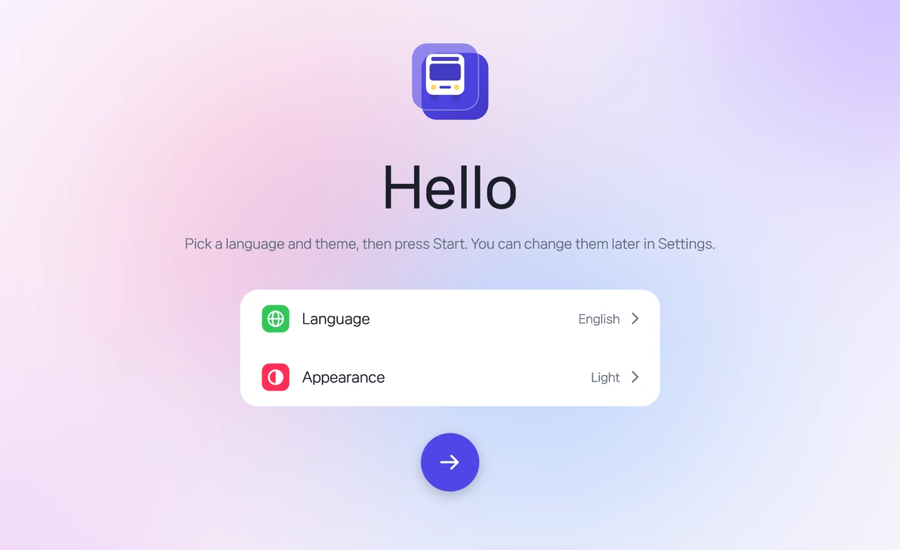

<p align="center">
  
</p>

<h1 align="center">Bus Depot</h1>

<p align="center">
  A tool for OMSI 2 that batch-converts <b>obj → x → o3d</b> from Blender folder by folder,<br>and also makes OMSI objects and splines, checks and edits buses (.bus), and inspects maps
</p>

<p align="center">
  <a href="https://github.com/HYB1022/obj2x/releases/latest"></a>
  <a href="https://github.com/HYB1022/obj2x/releases"></a>
  
  <a href="LICENSE"></a>
</p>

<p align="center">
  <a href="https://github.com/HYB1022/obj2x/releases/latest/download/BusDepot.zip"><b>⬇ Download BusDepot.zip</b></a>
  &nbsp;·&nbsp;
  <a href="#usage">Usage</a>
  &nbsp;·&nbsp;
  <a href="#troubleshooting">Troubleshooting</a>
</p>

<p align="center">
  <a href="README.md">한국어</a> · <b>English</b> · <a href="README.de.md">Deutsch</a> · <a href="README.ja.md">日本語</a> · <a href="README.zh.md">中文</a>
</p>

<p align="center">
  <picture>
    <source media="(prefers-color-scheme: dark)" srcset="docs/images/en/welcome-dark.webp">
    
  </picture>
</p>

> [!NOTE]
> **Since v2.7.3 the name changed from obj2x to Bus Depot.** The program is `BusDepot.exe` and the settings file is `BusDepot.ini`. Your old settings (`obj2x.ini`) are carried over on first start, and older versions still update automatically. Leftover old files are cleaned up; the `obj2x.exe` launcher stays so old shortcuts keep working.

Instead of opening files one by one, setting options and pressing Convert, **just pick a folder** and it does the rest.

- **Batch conversion**: converts every `.obj` in a folder to `.x` with Blender 2.79b, then to `.o3d` with OmsiXConv. The OmsiXConv check boxes (`X-File: z up` etc.) are set the way you chose.
- **Parallel processing**: runs several OmsiXConv instances at once and moves their windows off-screen so only this tool's window is visible.
- **Fast conversion (experimental)**: makes `.o3d` straight from obj without Blender or OmsiXConv, in about 0.1 s per file.
- **Results table**: vertices, triangles, materials, time taken and status (OK / warning / failed) for each file at a glance.
- **OMSI creation**: makes scenery objects (`.sco`) from o3d models and road splines (`.sli`) from lane and sidewalk values, right into your OMSI folder.
- **Bus**: open a `.bus` to see the model in 3D with its repaint, play its animations (`[newanim]`) and fix pivots, rotations and factors, and edit passenger paths (`paths.cfg`) and seats (`passengercabin.cfg`). It can also save a Blender file (`.blend`) or OBJ.
- **Map**: shows the map info and the layout of tiles, splines and objects, and finds missing objects, splines, AI vehicles and people. HOF files can be viewed too.

The `.o3d` is created in the same folder as the `.x`, with the same name as the obj (`face.obj` → `face.x` → `face.o3d`).

## Screenshots

<table>
  <tr>
    <td width="50%"></td>
    <td width="50%"></td>
  </tr>
  <tr>
    <td align="center"><b>Dashboard</b><br><sub>Vertices, triangles, materials and status per file in a results table</sub></td>
    <td align="center"><b>Conversion wizard</b><br><sub>Type → paths → options → done, four steps to start a conversion</sub></td>
  </tr>
  <tr>
    <td width="50%"></td>
    <td width="50%"></td>
  </tr>
  <tr>
    <td align="center"><b>Update notice</b><br><sub>A new version shows up in the <code>About</code> menu and installs with one button</sub></td>
    <td align="center"><b>Dark theme</b><br><sub>In <code>Settings</code> choose the theme (system / light / dark), accent (indigo / teal / rose), language (한국어 / English / Deutsch / 日本語 / 中文) and font</sub></td>
  </tr>
</table>

## Requirements

| Requirement | Notes |
| --- | --- |
| Windows 10 / 11 | The .NET Framework 4.x it needs is built into Windows |
| [Blender 2.79b](https://download.blender.org/release/Blender2.79/) | The bundled `Import-Export: DirectX X Format` add-on must be enabled. Other versions (2.8 and later) are not supported for conversion |
| OmsiXConv (Omsi X to O3D Converter 1.0) | **Not included in this repository.** Get it separately and set the location of `OmsiXConv.exe` |

The Blender you model in can be any version; 2.79b is only needed for the conversion. If you only use fast conversion, you need neither Blender nor OmsiXConv.

## Usage

1. Download the latest `BusDepot.zip` from [Releases](https://github.com/HYB1022/obj2x/releases/latest) and extract it to a **writable folder**. Settings are saved in `BusDepot.ini` in the same folder.
2. Run `BusDepot.exe` (or `BusDepot.bat`). On first start you need to accept the disclaimer.
3. In the `Advanced` tab, set the location of Blender 2.79's `blender.exe` and `OmsiXConv.exe`. They are remembered.
4. In the `Wizard`, choose the conversion type, set the OBJ folder (input) and the output folder, and start. Dropping an obj folder (or an obj file) onto the window or onto the `BusDepot.exe` icon opens the wizard with that folder; recently used folders can also be picked with one click.
5. Progress is shown by the progress bar and the `Log` / `Results table` tabs on the `Dashboard`, and on the Bus Depot taskbar button. If a conversion finishes while you are in another window, the taskbar button flashes.

| Conversion type | What it does |
| --- | --- |
| **DirectX → O3D** (recommended) | The standard way: makes `.x` with Blender 2.79b, then `.o3d` with OmsiXConv |
| **Blender .x only** | Makes only `.x` files, without OmsiXConv |
| **FastO3D** (experimental) | The built-in converter makes `.o3d` straight from obj. Please read [Fast conversion](#fast-conversion-experimental) first |

> [!NOTE]
> While OmsiXConv is converting, its hidden windows are receiving input, so please avoid using the mouse and keyboard as much as possible.

## Features

| Feature | Description |
| --- | --- |
| Include subfolders | Also converts obj files in subfolders. The output gets the same subfolder structure for `.x`/`.o3d` |
| Only changed obj | Converts only obj files newer than their `.o3d` (compared with `.x` when making only `.x`). Handy when exporting again and again while modelling |
| Stop | Closes Blender and every OmsiXConv and clears the queue |
| Retry failed | Failed files are listed in the `Results table` afterwards and `Retry Failed` runs only those. Files that already have an `.x` restart from the O3D step; files that failed in Blender or fast conversion start over |
| Missing texture warning | Before converting, checks that the textures named in each `.mtl` exist and, if not, lists them and asks whether to continue |
| Parallel count | How many OmsiXConv to run at once. The default is the number of logical cores − 1. OmsiXConv uses one core, so running more than your core count only slows it down |
| Update check | Checks GitHub for the latest release on start and shows an `Update` mark on the `About` menu when there is a new version |

### Advanced / Settings tabs

- **OmsiXConv options** (`Advanced`): `z up`, `Separate Files`, `Show Details of X`, `Remove Specular`, `Opt. Materials`, `Opt. Vertices`, `All Normals Up`, `Use Submesh Local Pos. as Global Pos.` are set this way for every conversion. The defaults are `z up` off and `Remove Specular` / `Opt. Materials` / `Opt. Vertices` on.
- **Extra Blender .x export options** (`Advanced`): one `name=value` per line for the export add-on (e.g. `ApplyModifiers=True`). Only names listed under `x exporter options:` in the log are applied; unknown names appear as `ignored options`.
- **Delete .x on success** (`Settings`): deletes the intermediate `.x` after a successful O3D conversion.
- **Font** (`Settings`): NanumSquare Neo (default), Noto Sans KR, MiSans or the Windows system font. NanumSquare Neo and Noto Sans KR are in the `fonts` folder. MiSans cannot be redistributed under its license, so download it from [Xiaomi's HyperOS font page](https://hyperos.mi.com/font) and install it in Windows or put it in the `fonts` folder. Without it, NanumSquare Neo is used.
- **Language files** (`Settings`): 한국어, English, Deutsch, 日本語 and 中文 are built in. The `Language files` button creates a `lang` folder with a translation template (`_template.json`) next to the exe. Copy the template to `<language code>.json` (e.g. `fr.json`), translate it and it appears in the language list. Saving under a built-in language's name changes only some of its texts.

## OMSI creation: objects / splines / bus / map

The OMSI 2 folder is found automatically from your Steam installation. If it isn't, click the `OMSI 2 folder` row on any of these pages and choose the folder that contains `Omsi.exe`.

- **Object maker**: choose a folder with o3d models (or drop it onto the window) to get a model list. `Create` makes `model\`, `texture\` and the `.sco` files in `Sceneryobjects\<folder name>`, and they appear in the map editor's object list.
  - One object per model, or all models combined into one object.
  - Collision, walkable surface (bridges, platforms), shadow and fixed can be switched on and off.
  - Textures with an alpha channel (tga/dds/png) automatically get a transparent material (`[matl_alpha]`): cutout (leaves, fences) or translucent (glass).
  - Textures are looked up in the model folder, next to it and in `texture` folders and copied. Textures that can't be found are listed at the end.
  - **Open a .sco**: choose an existing object's `.sco` (or drop it onto the window) to see it in 3D with textures. `More in the Bus tab` lets you switch parts one by one.
- **Spline maker**: set the number of lanes, lane width, two-way / one-way, sidewalk widths and curb height and the preview updates right away. `Create` makes the `.sli` and `texture\` in `Splines\<folder name>`.
  - Vehicle paths (one per lane, right-hand traffic) and pedestrian paths (one per sidewalk) are included. With a two-way road and an odd number of lanes you choose whether the extra lane goes left (opposite direction) or right (direction of travel).
  - Without chosen textures, a default asphalt and paving texture are created. The road texture can be stretched once over the whole road or once per lane.
  - **Open a .sli**: choose an existing spline's `.sli` (or drop it onto the window) to see it in 3D with textures as a straight 40 m road. Vehicle paths (forward green, backward orange) and pedestrian paths (blue) are shown with arrows, along with width, profile, texture and path counts.
- **Bus**: choose a `.bus` (or a `model.cfg`, or an object `.sco`) or drop it onto the window to see it in 3D with textures. Drag to rotate, right-drag to pan, wheel to zoom.
  - **Animation**: every variable used by `anim_rot` / `anim_trans` in the cfg gets a slider and a `Play` button, and doors, wipers, gauge needles etc. move as in OMSI (pivot `origin_trans`, axis `origin_rot`, `origin_from_mesh`, stacked blocks). If it differs from the game, try the other block order or flip the rotation direction.
  - **Part editing**: click a part in 3D or `Edit` in the part list to get pivot, rotation and factor fields for each block; changes move the part right away, and pivots and axes are drawn in 3D. `Save cfg` only rewrites the lines holding those values, so comments and everything else stay as they were, and the original is kept as `.bak` on the first save.
  - **Passenger paths / seats**: the points (entry orange, exit red) and links of the `paths.cfg` named in the `.bus` and the seats of `passengercabin.cfg` (driver pink, the bar shows the facing direction) are drawn over the model. Coordinates can be edited, points, links and seats added or removed, and saved. Drag a point or seat in 3D to move it (free move parallel to the screen like Blender, hold `Shift` for 1 m steps). Drag the red/green/blue arrows of the selected point or seat to move along x/y/z only. `Hide model` turns the whole model off so only paths and seats are shown. `Ctrl+Z` undoes, `Ctrl+Y` (or `Ctrl+Shift+Z`) redoes.
  - At first only the most detailed LOD's exterior parts are on. Conditional parts (`[visible]`) can be switched one by one in the part list, or all at once with `Outside` / `Inside` / `All`.
  - **Repaint**: pick a `.cti` from the `[CTC]` repaint folder to apply its textures; its `[setvar]` options switch conditional parts on and off. A `.cti` with several repaints lists each of them. Options that a vehicle script (`.osc`) derives from repaint values (e.g. door style by model year) are matched by running the script in a simple way. Unset variables are 0, as in OMSI. The first repaint is chosen at the start. Transparency is used only for materials with `[matl_alpha]`, as in OMSI.
  - Like OMSI, only front faces are drawn, so faces with flipped normals are invisible as in the game. `Show back faces` draws both sides.
  - Parts that the game moves into place by animation (plug-in signs etc.) sit outside the body in the file and start switched off.
  - **Save as Blender file**: the parts that are on are opened in the newest Blender installed (found automatically in Program Files and Steam, or choose one) and saved as a `.blend` with the textures packed in. Each part becomes an object, and faces stay triangles as OMSI needs them. The orientation matches OMSI (z up, bus length along y). You can also save just `.obj` + `.mtl` without Blender.
  - Encrypted o3d files (such as OMSI's stock vehicles) are not opened.
- **Map**: choose (or drop) a map folder inside `maps` (the one with `global.cfg`) to see the map's name, description, picture, years, default depot and line/trip counts, and a map of its tiles, splines (including curves) and objects. Drag to move, wheel to zoom.
  - **Missing files**: objects and splines missing from your OMSI folder (with how often they are used), AI vehicles (`ailists.cfg`) and people (`humans.txt`, `drivers.txt`) are collected and drawn red on the map. `Copy list` puts them on the clipboard.
  - **AI / people**: vehicle types and counts per AI group, and the passenger and driver lists.
  - **HOF viewer**: pick a `.hof` from OMSI's vehicle folders to see its termini, bus stops and trips (line, code, stop order). A hof that several vehicles carry with exactly the same name and content is listed once. You can also drop a `.hof` onto the window.

> [!NOTE]
> The created files use only OMSI's basic keywords (no night textures, LOD, traffic lights, crossings etc.). For anything more, open the created `.sco` / `.sli` in a text editor.

### Fast conversion (experimental)

> [!WARNING]
> **This is experimental.** It was built by reverse-engineering OmsiXConv's output format, so identical results can't be guaranteed for every model. For important models, compare with the standard way first and use the standard way if anything is off.

Compared with OmsiXConv's `.o3d` in the cases tested, triangles, materials and UVs are identical (normals differ by less than 0.001; the vertex count can differ by a few). The following are not supported or not verified yet:

- obj files split into several objects: merged into one mesh and per-object origins are not kept. Not verified against OmsiXConv
- Models with more than 65,535 vertices or triangles (reported as failed)
- OmsiXConv options (`z up` etc.) and extra Blender options are not applied

## Updating

When a new version is available, an `Update` mark appears next to the `About` menu and on the `Update` row of the `About` tab. `Update` downloads the release zip, overwrites the same folder and restarts.

- Your settings (`BusDepot.ini`) are kept.
- The previous `BusDepot.exe`, `BusDepot.bat` and `BusDepot.py` are kept in the `BusDepot_backup` folder.
- Even v2.0 (the PowerShell version) updates straight to the latest version.
- If you don't want it to contact GitHub on start, turn off `Check for updates on start` in `Settings`.
- The downloaded files are not verified separately. Use it only if you trust this repository's releases.

## Troubleshooting

| Problem | What to check |
| --- | --- |
| Windows blocks or warns about the program | `BusDepot.exe` is not code-signed, so SmartScreen may warn. Click `More info` → `Run anyway`, or check the source (`src/`) and build it yourself with `build.bat` |
| Errors about `blender.exe` | Make sure you chose the `blender.exe` of 2.79b (it is not detected automatically) |
| `E/A-Fehler 103` now and then | An OmsiXConv error. It retries up to 3 times automatically; if it keeps happening, lower the parallel count |
| `OmsiXConv window not found` in the log | Check the OmsiXConv path and that no other program covers its window |
| `File dialog not found` in the log | Please report the window list shown in brackets as an issue |
| Model is rotated wrongly | Check OmsiXConv's `z up` in the `Advanced` tab (off by default) |

If something goes wrong, please open an [issue](https://github.com/HYB1022/obj2x/issues) with the log. The tool was made on my setup and may behave differently elsewhere. Large `.x` files (several MB) can take a while.

## Building it yourself

`build.bat` builds `src\Core` (logic) and `src\App` (WPF UI) into `BusDepot.exe` with the C# compiler that ships with Windows (.NET Framework 4). Nothing else needs to be installed.

```bat
build.bat
BusDepot.exe --selftest
```

`--selftest` checks the settings, texts, converters and UI automatically and writes `PASS` / `FAIL` lines to `BusDepot_selftest.txt` in the same folder.

## Disclaimer

On first start a disclaimer is shown, and you need to accept it to use the tool. Your choice is saved in `BusDepot.ini`, and the disclaimer can be read again from `Disclaimer` in the `About` tab. This is an unofficial tool made by individuals; it is not affiliated with Blender, OmsiXConv or OMSI, and there is no warranty or liability for conversion results or damaged files. Back up important files and check the results yourself.

Blender and OmsiXConv are not included in this repository. Each program is under its own license.

**Credits**: [HYB1022](https://github.com/HYB1022) · [qbasys08](https://github.com/qbasys08) · [Claude (Anthropic)](https://www.anthropic.com/claude)

## Changelog

- **v2.7.8** — Map tab: depot vehicle groups (`[aigroup_depot_typgroup]`) no longer show up as empty groups in the AI list (they count as the depot's vehicles). Object tab: opening a .sco made of encrypted o3d files now says so instead of "files not found"
- **v2.7.7** — Bus tab: **drag passenger path points and seats in 3D** (free move, red/green/blue arrows for x/y/z, `Shift` for 1 m steps), **hide model** (paths and seats only), **undo/redo** (`Ctrl+Z` / `Ctrl+Y`), normal cursor over handles. Fixed interiors not showing through glass (transparent materials are drawn last). README screenshots per language
- **v2.7.6** — **Open a .sco** in the Object tab (3D with textures) and **open a .sli** in the Spline tab (3D as a straight 40 m road, vehicle/pedestrian paths with directions, width, profile and texture info). Dropping a `.sco`/`.sli` onto the window opens it too
- **v2.7.5** — **Bus** tab: open a `.bus` to see model, repaint and animations (`[newanim]`) and edit pivots, rotations and factors, passenger paths (`paths.cfg`) and seats (`passengercabin.cfg`) (replaces the model viewer tab). Animation variable ranges as in OMSI: doors and wipers 0–1, only steering and the like −1–1. **Map** tab: map info, a map of tiles, splines and objects, missing objects, splines, AI vehicles and people, AI lists, HOF viewer (identical hofs merged). Large maps no longer freeze (only what is visible is drawn). Old files left over from obj2x are cleaned up after upgrading, `Set path` in the missing-tools warning jumps straight to the bottom of Advanced, one sidebar header, fixed square hover on rounded cards, README in English, German, Japanese and Chinese
- **v2.7.4** — Model viewer: **choose a repaint (.cti)**, its textures are applied and conditional parts (`[visible]`) follow its `[setvar]` options. **Front faces only** as in OMSI (faces with flipped normals are hidden, `Show back faces` to see them); backface culling is also turned on per material when saving to Blender. **.blend is saved with the newest installed Blender** (fixes missing textures and the layout ending up at the bottom in Blender 2.8+, or choose one). Splines: with an odd lane count on a two-way road, **choose whether the extra lane goes left or right**. Sharper README animation
- **v2.7.3** — Renamed to **Bus Depot** (settings, shortcuts and old versions' auto-update carry over), new logo. **Model viewer**: bus model.cfg / object .sco in 3D with textures, saved as a Blender file (.blend) or OBJ (finds parts even when the cfg sits in a subfolder like `Model\cfg\`). **Object maker** (.sco + copying models/textures), **spline maker** (lanes and sidewalks → .sli with a preview). Drag and drop folders/files onto the window or the exe, taskbar progress and completion notice, retry only failed files (including the Blender and fast conversion steps), missing texture warning before converting, press ripple on rows without an action
- **v2.7.2** — Fixed Windows Defender wrongly flagging v2.7.1 as `Trojan:Win32/Bearfoos.A!ml` (the developer self-test no longer copies the exe to a temp folder to run it; the exe now has name, version and description info)
- **v2.7.1** — The About update button moved down right above the list with larger text, as a translucent HyperOS-style plate the gradient shows through
- **v2.7** — With an update available the About title slides up smoothly and an `Update` button appears below it (like HyperOS); Advanced and Settings in the HyperOS settings style (rows highlight on hover); credits in the disclaimer; fixed the font drop-down going blank and the theme/accent highlight misaligning after a language change
- **v2.6** — Languages moved to files (`lang/*.json`) so users can add their own; Japanese (日本語) and Chinese (中文); NanumSquare Neo as the default font with a font choice (NanumSquare Neo / Noto Sans KR / system); the update check result slides in as an `Update` mark; ripple from the press point; redesigned first-run welcome screen (greetings in every language); a split layout like Xiaomi's tablet settings; MiSans support (if installed); starts in a window
- **v2.5** — German (Deutsch), starting in German when Windows is German; animations synced to the display refresh rate (60 fps); welcome greeting centered under the logo
- **v2.4** — UI rebuilt in WPF with logic and UI separated; version/status moved to the bottom of the sidebar so the right side uses the full window height; parallel count number box (typing, wheel, hold to repeat); language drop-down; theme switch animation; About screen CPU use cut to about a third (paused while you use another window); vertical alignment fixes
- **v2.3** — New-version notice changed from a red dot to an `Update` mark next to the `About` menu; license changed to GPL-3.0
- **v2.2** — New-version notice shown as an update row in the `About` tab instead of a full-screen window (install directly with `Update`); icons for every sidebar menu
- **v2.1** — Moved from a PowerShell script to an executable (`obj2x.exe`, C#). Existing settings (`obj2x.ini`) and the disclaimer acceptance carry over, and it installs through v2.0's auto-update

<details>
<summary>Older versions (v1.1 – v2.0)</summary>

Executables of v2.2 and earlier are no longer distributed. Please get the latest version through the auto-update.

- **v2.0** — New look (cards, progress bar, light/dark theme chosen in the options window), fast conversion results table, disclaimer on first start
- **v1.9** — Include subfolders option, drop a folder onto the OBJ folder field, warnings in the fast conversion log (no mtl / material missing from the mtl / several objects merged)
- **v1.8** — Fast conversion (built-in, experimental): `.o3d` straight from obj without Blender/OmsiXConv
- **v1.7** — Default parallel count follows the PC's core count (the old fixed 10 could be slower on PCs with few cores), core count shown
- **v1.6** — O3D conversion starts with the largest files to shorten the total time
- **v1.5** — Conversion times shown (Blender step, prepare/convert time per file, total O3D time)
- **v1.4** — Fixed an error when pressing `OK` in the options window that kept settings from being saved
- **v1.3** — Convert only changed obj, stop / retry failed, options window (all OmsiXConv check boxes, delete .x, extra export options), automatic update installation
- **v1.1** — First release: batch obj → x → o3d, `z up` turned off automatically, parallel conversion, output same as input option, update check

</details>

## License

Copyright (C) 2026 Hyunwoo Bang, Junyoung

[GNU General Public License v3.0 or later](LICENSE) (GPL-3.0-or-later). You may use, modify and redistribute it freely, but when you distribute a modified version you must publish its source code under the same GPL license.

Versions before v2.2 were released under the MIT license.
