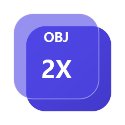
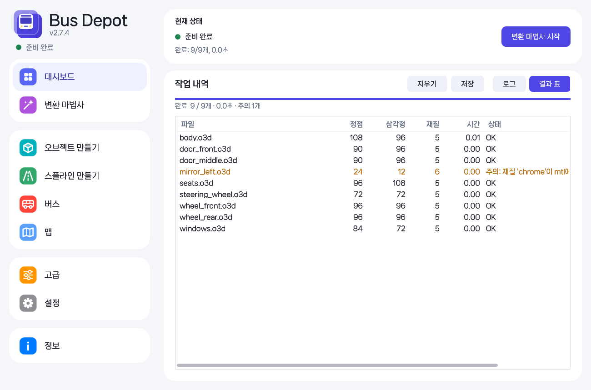
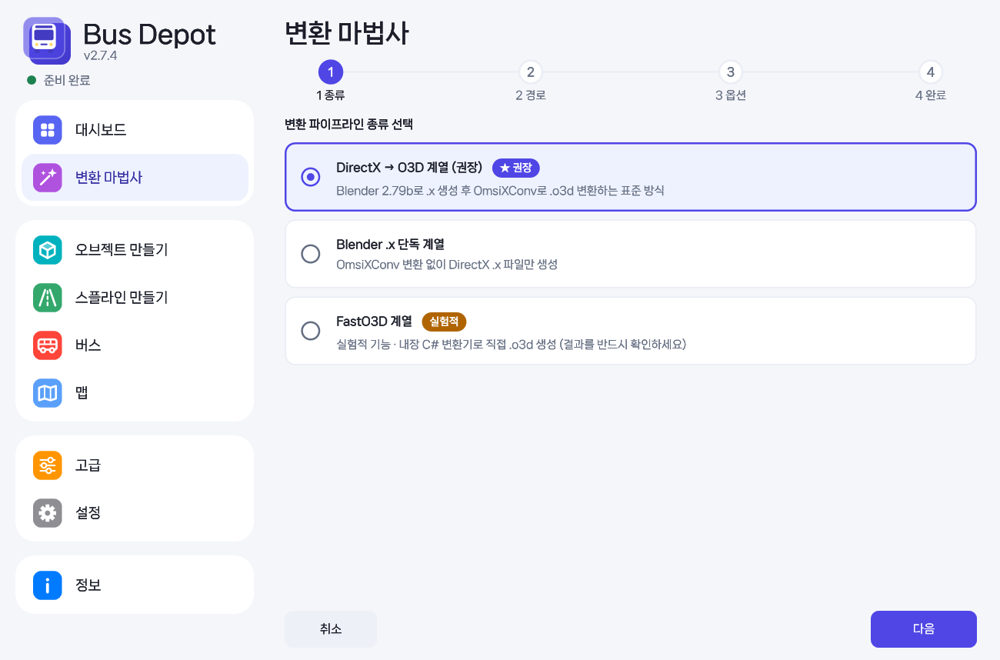
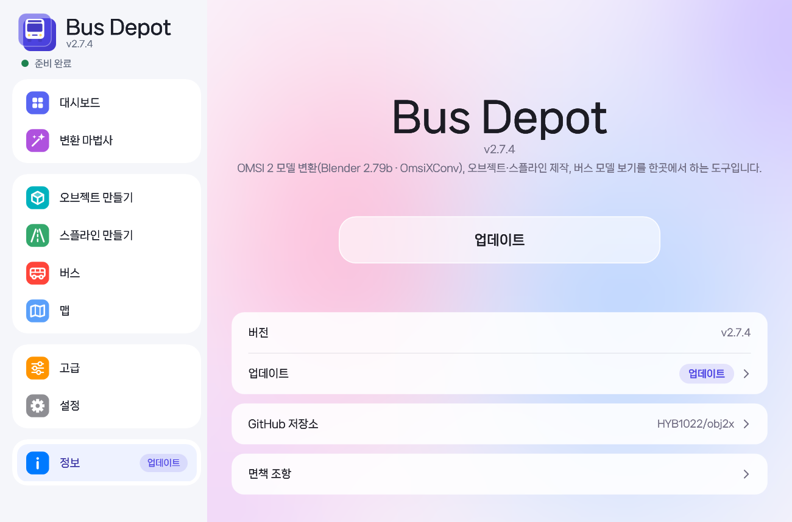
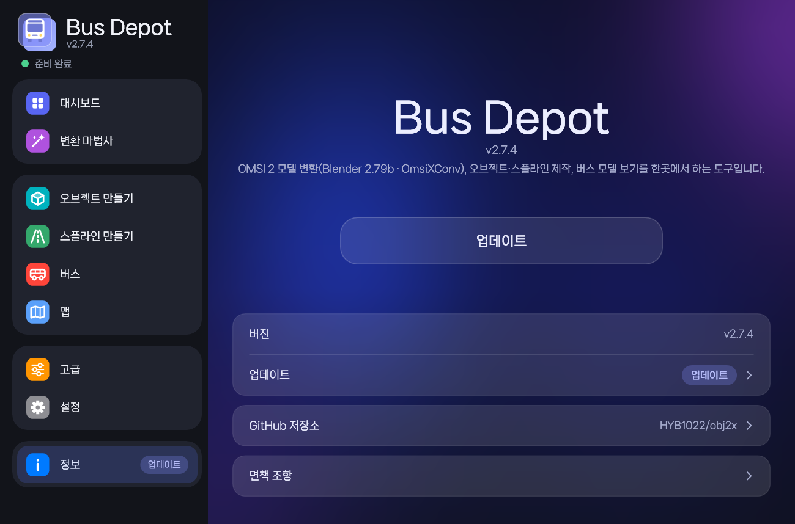

<p align="center">
  
</p>

<h1 align="center">Bus Depot</h1>

<p align="center">
  Blender から書き出した <b>obj → x → o3d</b> の変換をフォルダー単位でまとめて行い、<br>OMSI のオブジェクト・スプライン作成、バス（.bus）の確認・編集、マップの点検までできる OMSI 2 用ツール
</p>

<p align="center">
  <a href="https://github.com/HYB1022/obj2x/releases/latest"></a>
  <a href="https://github.com/HYB1022/obj2x/releases"></a>
  
  <a href="LICENSE"></a>
</p>

<p align="center">
  <a href="https://github.com/HYB1022/obj2x/releases/latest/download/BusDepot.zip"><b>⬇ BusDepot.zip をダウンロード</b></a>
  &nbsp;·&nbsp;
  <a href="#使い方">使い方</a>
  &nbsp;·&nbsp;
  <a href="#トラブルシューティング">トラブルシューティング</a>
</p>

<p align="center">
  <a href="README.md">한국어</a> · <a href="README.en.md">English</a> · <a href="README.de.md">Deutsch</a> · <b>日本語</b> · <a href="README.zh.md">中文</a>
</p>

<p align="center">
  <picture>
    <source media="(prefers-color-scheme: dark)" srcset="docs/images/welcome-dark.webp">
    
  </picture>
</p>

> [!NOTE]
> **v2.7.3 から名前が obj2x から Bus Depot に変わりました。** 実行ファイルは `BusDepot.exe`、設定は `BusDepot.ini` です。以前の設定（`obj2x.ini`）は初回起動時にそのまま引き継がれ、旧バージョンの自動アップデートも引き続き動きます。残った古いファイルは片付け、ショートカットが動くように `obj2x.exe` ランチャーだけを残します。

ファイルを一つずつ開いてオプションを合わせ Convert を押していた作業を、**フォルダーを指定するだけ**で自動で行います。

- **一括変換**：フォルダー内の `.obj` を Blender 2.79b で `.x` に、続けて OmsiXConv で `.o3d` まで変換します。OmsiXConv のチェックボックス（`X-File: z up` など）は決めておいた状態に自動で合わせます。
- **並列処理**：OmsiXConv を同時に複数起動し、そのウィンドウは画面外に移して、このツールのウィンドウだけが見えるようにします。
- **高速変換（実験的）**：Blender と OmsiXConv なしで obj から直接 `.o3d` を作ります。1 ファイルあたり約 0.1 秒です。
- **結果表**：ファイルごとの頂点・三角形・マテリアル数、所要時間、状態（OK / 注意 / 失敗）をひと目で表示します。
- **OMSI 作成**：o3d モデルからオブジェクト（`.sco`）を、車線・歩道の値から道路スプライン（`.sli`）を作り、OMSI フォルダーに直接入れます。
- **バス**：`.bus` を開いてモデルを塗装まで 3D で表示し、アニメーション（`[newanim]`）を動かしながらピボット・回転・factor を直し、乗客の経路（`paths.cfg`）と座席（`passengercabin.cfg`）を編集して保存します。Blender ファイル（`.blend`）や OBJ にも保存できます。
- **マップ**：マップ情報とタイル・スプライン・オブジェクトの配置を地図で表示し、足りないオブジェクト・スプライン・AI 車両・人を見つけます。HOF ファイルも閲覧できます。

`.o3d` は `.x` と同じフォルダーに作られ、ファイル名は obj と同じです（`face.obj` → `face.x` → `face.o3d`）。

## 画面

<table>
  <tr>
    <td width="50%"></td>
    <td width="50%"></td>
  </tr>
  <tr>
    <td align="center"><b>ダッシュボード</b><br><sub>ファイルごとの頂点・三角形・マテリアル数と状態を結果表で表示</sub></td>
    <td align="center"><b>変換ウィザード</b><br><sub>種類 → パス → オプション → 完了の 4 ステップで変換を開始</sub></td>
  </tr>
  <tr>
    <td width="50%"></td>
    <td width="50%"></td>
  </tr>
  <tr>
    <td align="center"><b>アップデートのお知らせ</b><br><sub>新しいバージョンがあると <code>情報</code> メニューに表示され、ボタン一つでインストール</sub></td>
    <td align="center"><b>ダークテーマ</b><br><sub><code>設定</code> でテーマ（システム / ライト / ダーク）、アクセント色（インディゴ / ティール / ローズ）、言語（한국어 / English / Deutsch / 日本語 / 中文）、フォントを選べます</sub></td>
  </tr>
</table>

## 必要なもの

| 必要なもの | 説明 |
| --- | --- |
| Windows 10 / 11 | 実行に必要な .NET Framework 4.x は Windows に標準で入っています |
| [Blender 2.79b](https://download.blender.org/release/Blender2.79/) | 標準の `Import-Export: DirectX X Format` アドオンが有効になっている必要があります。他のバージョン（2.8 以降）は変換に対応していません |
| OmsiXConv (Omsi X to O3D Converter 1.0) | **このリポジトリには含まれていません。** 別途入手して `OmsiXConv.exe` の場所を指定してください |

モデリングに使う Blender のバージョンは問いません。2.79b は変換にだけ必要です。高速変換だけを使うなら Blender も OmsiXConv も不要です。

## 使い方

1. [Releases](https://github.com/HYB1022/obj2x/releases/latest) から最新の `BusDepot.zip` をダウンロードし、**書き込みできるフォルダー**に展開します。設定は同じフォルダーの `BusDepot.ini` に保存されます。
2. `BusDepot.exe`（または `BusDepot.bat`）を実行します。初回起動時は免責事項への同意が必要です。
3. `詳細` タブで Blender 2.79 の `blender.exe` と `OmsiXConv.exe` の場所を指定します。一度指定すると保存されます。
4. `変換ウィザード` で変換方式を選び、OBJ フォルダー（入力）と出力フォルダーを指定して変換を開始します。obj フォルダー（または obj ファイル）をウィンドウや `BusDepot.exe` のアイコンにドラッグ＆ドロップするとそのフォルダーでウィザードが開き、最近使ったフォルダーをクリックして選ぶこともできます。
5. 進行状況は `ダッシュボード` の進行バーと `ログ` / `結果表` タブ、タスクバーの Bus Depot ボタンに表示されます。別のウィンドウを見ている間に変換が終わるとタスクバーのボタンが点滅します。

| 変換方式 | 内容 |
| --- | --- |
| **DirectX → O3D**（推奨） | Blender 2.79b で `.x` を作り、OmsiXConv で `.o3d` まで変換する標準の方式 |
| **Blender .x のみ** | OmsiXConv を使わず `.x` だけを作ります |
| **FastO3D**（実験的） | 内蔵の変換器で obj から直接 `.o3d` を作ります。先に下の[高速変換](#高速変換実験的機能)をお読みください |

> [!NOTE]
> OmsiXConv で変換している間は、見えない OmsiXConv のウィンドウが入力を受けているので、マウスとキーボードはできるだけ触らないでください。

## 機能

| 機能 | 説明 |
| --- | --- |
| サブフォルダーを含める | 入力フォルダー内のサブフォルダーの obj も探して変換します。出力フォルダーにも同じ構造で `.x`/`.o3d` が作られます |
| 変更された obj のみ | `.o3d` より新しく更新された obj だけを変換します（`.x` だけ作るときは `.x` と比較）。モデリング中に何度も書き出すときに便利です |
| 停止 | Blender と OmsiXConv をすべて終了し、待ち行列を空にします |
| 失敗したものだけ再試行 | 失敗したファイルは終了後 `結果表` に表示され、`失敗したものだけ再試行` でそのファイルだけをやり直します。`.x` まで作れたファイルは O3D の段階から、Blender や高速変換で失敗したファイルは最初からやり直します |
| テクスチャ不足の警告 | 変換前に `.mtl` に書かれたテクスチャがあるか確認し、なければ一覧を表示して続けるか尋ねます |
| 同時実行数 | OmsiXConv をいくつ同時に起動するかを決めます。既定値は論理コア数 − 1 です。OmsiXConv はコアを 1 つしか使わないので、コア数より多く起動するとかえって遅くなります |
| アップデート確認 | 起動時に GitHub で最新リリースを確認し、新しいバージョンがあれば `情報` メニューの `アップデート` 表示で知らせます |

### 詳細 / 設定タブ

- **OmsiXConv の詳細オプション**（`詳細`）：`z up`、`Separate Files`、`Show Details of X`、`Remove Specular`、`Opt. Materials`、`Opt. Vertices`、`All Normals Up`、`Use Submesh Local Pos. as Global Pos.` を変換のたびにここで決めた状態に自動設定します。既定値は `z up` オフ、`Remove Specular` / `Opt. Materials` / `Opt. Vertices` オンです。
- **Blender .x 書き出しの追加オプション**（`詳細`）：書き出しアドオンのオプションを `名前=値` で 1 行ずつ書きます（例：`ApplyModifiers=True`）。ログの `x exporter options:` 一覧にある名前だけが適用され、ない名前は `ignored options` と表示されます。
- **成功したら .x を削除**（`設定`）：O3D 変換に成功したら中間ファイルの `.x` を削除します。
- **フォント**（`設定`）：NanumSquare Neo（既定）、Noto Sans KR、MiSans、Windows のシステムフォントから選びます。NanumSquare Neo と Noto Sans KR は `fonts` フォルダーに入っています。MiSans はライセンス上同梱できないので、[Xiaomi の HyperOS フォントページ](https://hyperos.mi.com/font)から入手して Windows にインストールするか `fonts` フォルダーに入れてください。ない場合は NanumSquare Neo で表示されます。
- **言語ファイル**（`設定`）：한국어、English、Deutsch、日本語、中文 に対応しています。`言語ファイル` ボタンを押すと exe の横に `lang` フォルダーと翻訳テンプレート（`_template.json`）が作られます。テンプレートを `<言語コード>.json`（例：`fr.json`）としてコピーして翻訳すると言語一覧に表示されます。内蔵言語と同じ名前で保存すると、その言語の一部の文言だけを変えられます。

## OMSI 作成：オブジェクト / スプライン / バス / マップ

OMSI 2 フォルダーは Steam のインストール情報から自動で探します。見つからない場合は各画面の `OMSI 2 フォルダー` の行を押して `Omsi.exe` があるフォルダーを指定してください。

- **オブジェクト作成**：o3d モデルのあるフォルダーを選ぶと（ウィンドウにドロップしても可）モデル一覧が表示されます。作成を押すと `Sceneryobjects\<フォルダー名>` に `model\`、`texture\`、`.sco` が作られ、マップエディターのオブジェクト一覧に表示されます。
  - モデルごとにオブジェクトを作るか、すべてまとめて 1 つのオブジェクトにできます。
  - 衝突、上を歩ける（橋・ホーム）、影、固定をオン/オフできます。
  - アルファチャンネルのあるテクスチャ（tga/dds/png）は自動で透明マテリアル（`[matl_alpha]`）になります。切り抜き（葉・金網）か半透明（ガラス）を選べます。
  - テクスチャはモデルフォルダー、その隣、`texture` フォルダーから探してコピーします。見つからなかったテクスチャは最後に一覧で知らせます。
- **スプライン作成**：車線数、車線幅、対面通行/一方通行、歩道幅、縁石の高さを決めるとプレビューがすぐ変わり、作成を押すと `Splines\<フォルダー名>` に `.sli` と `texture\` が作られます。
  - 車の通る経路（車線ごと、右側通行）と人の通る経路（歩道ごと）が入ります。対面通行で車線数が奇数のときは、余る 1 車線を左（逆方向）と右（進行方向）のどちらに置くか選べます。
  - 路面・歩道のテクスチャを選ばない場合は、既定のアスファルトと舗装ブロックのテクスチャを作ります。路面テクスチャは道路全体に 1 回、または車線ごとに 1 回貼れます。
- **バス**：`.bus`（または `model.cfg`、オブジェクトの `.sco`）を選ぶかウィンドウにドロップすると、テクスチャ付きで 3D 表示します。ドラッグで回転、右ドラッグで移動、ホイールで拡大します。
  - **アニメーション**：cfg の `anim_rot` / `anim_trans` で使われる変数ごとにスライダーと `再生` ボタンが付き、ドア・ワイパー・計器の針などが OMSI のように動きます（ピボット `origin_trans`、回転軸 `origin_rot`、`origin_from_mesh`、複数ブロックの重ね合わせ）。ゲームと違う場合はブロックの適用順と回転方向を切り替えられます。
  - **パーツ編集**：3D でパーツをクリックするか一覧の `編集` を押すと、ブロックごとにピボット・回転・factor の欄が出て、直したとおりにすぐ動きます。ピボットと回転軸も 3D に表示されます。`cfg を保存` は値が書かれた行だけを書き換えるので、コメントや他の内容はそのまま残り、初回保存時に元のファイルを `.bak` として残します。
  - **乗客の経路 / 座席**：`.bus` に書かれた `paths.cfg` の点（入口はオレンジ、出口は赤）とつながり、`passengercabin.cfg` の座席（運転席はピンク、棒は座る向き）をモデルに重ねて表示し、座標を直したり点・つながり・座席を追加・削除して保存できます。
  - 最初は最も詳細な LOD の外から見えるパーツだけがオンになります。条件付きパーツ（`[visible]`）はパーツ一覧で一つずつ、または `外` / `内` / `すべて` でまとめて切り替えられます。
  - **塗装**：`[CTC]` 塗装フォルダーの `.cti` を選ぶとその塗装のテクスチャを貼り、`.cti` の `[setvar]` オプションどおりに条件付きパーツをオン/オフします。1 つの `.cti` に塗装が複数あれば別々に選べます。車両スクリプト（`.osc`）が塗装の値から決めるオプション（年式によるドアの形など）も、スクリプトを簡易的に実行して合わせます。指定のない変数は OMSI と同じく 0 とみなします。最初は 1 番目の塗装が選ばれます。透明は `[matl_alpha]` のあるマテリアルにだけ適用します（OMSI と同じ）。
  - OMSI と同じく表面だけを描きます。法線が反転した面はゲームと同じく見えず、`裏面も表示` をオンにすると両面で描きます。
  - ゲーム内でアニメーションによって所定の位置に移されるパーツ（差し込み式の表示板など）は、ファイル上の位置が車体の外なので最初はオフにしてあります。
  - **Blender ファイルとして保存**：オンにしたパーツを、インストール済みの Blender のうち最新のもの（Program Files と Steam から自動で探します。自分で選ぶことも可）で読み込み、テクスチャも埋め込んだ `.blend` として保存します。パーツごとにオブジェクトが 1 つでき、三角形は編集しやすいように四角形にまとめます。向きは OMSI と同じです（z が上、車の長さ方向は y）。Blender なしで `.obj` + `.mtl` だけを保存することもできます。
  - 暗号化された o3d（OMSI 標準車両など）は開きません。
- **マップ**：`maps` 内のマップフォルダー（`global.cfg` のある場所）を選ぶかドロップすると、マップ名・説明・画像・年・既定の車庫・路線/運行数とともに、タイル・スプライン（曲線を含む）・オブジェクトを地図で表示します。ドラッグで移動、ホイールで拡大します。
  - **足りないファイル**：OMSI フォルダーにないオブジェクト・スプライン（使用回数）、AI 車両（`ailists.cfg`）、人（`humans.txt`、`drivers.txt`）をまとめて表示し、地図上で赤く示します。`一覧をコピー` でクリップボードに入れられます。
  - **AI / 人**：AI グループごとの車両の種類と台数、乗客・運転士の一覧を表示します。
  - **HOF ビューアー**：OMSI 車両フォルダーの `.hof` を選んで、終点・停留所の一覧と運行（路線、コード、停留所の順番）を見られます。`.hof` をウィンドウにドロップしても開けます。

> [!NOTE]
> 作られるファイルは OMSI の基本的な形式だけを使います（夜間テクスチャ、LOD、信号、交差点などは入りません）。さらに手を加える場合は、作られた `.sco` / `.sli` をメモ帳で開いて編集してください。

### 高速変換（実験的機能）

> [!WARNING]
> **実験的機能です。** OmsiXConv の出力形式を解析して作ったものなので、すべてのモデルで同じ結果になるとは保証できません。重要なモデルは最初に従来の方式と結果を比べ、問題があれば従来の方式で変換してください。

OmsiXConv の `.o3d` と照らし合わせて確認した範囲では、三角形・マテリアル・UV は同じです（法線の差は 0.001 以内、頂点数は数個異なることがあります）。次の点はまだ対応していないか確認できていません。

- 複数のオブジェクトに分かれた obj：1 つのメッシュにまとめられ、オブジェクトごとの原点は保たれません。OmsiXConv と同じ結果になるかは未確認です
- 頂点または三角形が 65,535 を超えるモデル（失敗と表示されます）
- OmsiXConv の詳細オプション（`z up` など）と Blender の追加オプションは適用されません

## アップデート

起動時に新しいバージョンがあると、サイドバーの `情報` メニューの右と `情報` タブの `アップデート` の行に `アップデート` 表示が出ます。`アップデート` を押すとリリースの zip をダウンロードして同じフォルダーに上書きし、再起動します。

- 設定（`BusDepot.ini`）はそのまま残ります。
- 以前の `BusDepot.exe`、`BusDepot.bat`、`BusDepot.py` は `BusDepot_backup` フォルダーに保管されます。
- v2.0（PowerShell 版）からもそのまま最新バージョンにアップデートできます。
- 起動時に GitHub に接続したくない場合は、`設定` で `起動時にアップデートを確認` をオフにしてください。
- ダウンロードしたファイルの完全性は別途検証していません。このリポジトリのリリースを信頼する場合にのみ使ってください。

## トラブルシューティング

| 症状 | 確認すること |
| --- | --- |
| Windows が実行をブロックする・警告する | `BusDepot.exe` はコード署名がないため SmartScreen の警告が出ることがあります。`詳細情報` → `実行` を押すか、ソース（`src/`）を確認して `build.bat` で自分でビルドしてください |
| `blender.exe` 関連のエラー | 2.79b の `blender.exe` を指定したか確認してください（自動検出はしません） |
| `E/A-Fehler 103` がときどき出る | OmsiXConv 側のエラーです。自動で最大 3 回再試行し、続く場合は同時実行数を減らしてみてください |
| ログに `OmsiXConv のウィンドウが見つかりません` | OmsiXConv のパスが正しいか、他のプログラムがそのウィンドウを遮っていないか確認してください |
| ログに `ファイル選択ウィンドウが見つかりません` | かっこ内のウィンドウ一覧を Issue で知らせてください |
| モデルの向きがおかしい | `詳細` タブで OmsiXConv の `z up` の状態を確認してください（既定はオフ） |

問題があればログの内容とともに [Issue](https://github.com/HYB1022/obj2x/issues) で知らせてください。私の環境で作ったツールなので、他の環境では動作が異なる場合があります。大きな `.x`（数 MB 以上）は変換に時間がかかることがあります。

## 自分でビルドする

`build.bat` を実行すると、Windows に標準で入っている C# コンパイラー（.NET Framework 4）で `src\Core`（変換ロジック）と `src\App`（WPF 画面）を `BusDepot.exe` にビルドします。別途インストールするものはありません。

```bat
build.bat
BusDepot.exe --selftest
```

`--selftest` は設定・文言・変換器・画面構成を自動で点検し、結果を同じフォルダーの `BusDepot_selftest.txt` に `PASS` / `FAIL` の行で残します。

## 免責事項

初回起動時に免責事項が表示され、同意すると使えるようになります。同意の有無は `BusDepot.ini` に保存され、`情報` タブの `免責事項` から再表示できます。このツールは個人が作った非公式ツールで、Blender、OmsiXConv、OMSI とは関係がなく、変換結果やファイルの破損などについて保証も責任も負いません。重要なファイルはバックアップし、結果をご自身で確認してください。

このリポジトリには Blender と OmsiXConv は含まれていません。各プログラムのライセンスはそれぞれに従います。

**クレジット**：[HYB1022](https://github.com/HYB1022) · [qbasys08](https://github.com/qbasys08) · [Claude (Anthropic)](https://www.anthropic.com/claude)

## 変更履歴

- **v2.7.4** — モデル表示で **塗装（.cti）を選択**：塗装のテクスチャを貼り、`[setvar]` オプションどおりに条件付きパーツ（`[visible]`）をオン/オフ。OMSI と同じく **表面だけを描画**（法線が反転した面は非表示、`裏面も表示` でオン）、Blender への保存時もマテリアルごとに裏面非表示をオン。**.blend はインストール済みの最新の Blender で保存**（Blender 2.8 以降でテクスチャが表示されず画面配置が下に移る問題を修正、自分で選ぶことも可）。スプライン：対面通行で車線数が奇数のとき **余る車線を左/右から選択**。README 冒頭のアニメーションをより鮮明に
- **v2.7.3** — 名前を **Bus Depot** に変更（設定・ショートカット・旧バージョンの自動アップデートは引き継ぎ）、新しいロゴ。**モデル表示**：バスの model.cfg / オブジェクトの .sco をテクスチャ付きで 3D 表示し、Blender ファイル（.blend）や OBJ に保存（cfg が `Model\cfg\` のようなサブフォルダーにあってもパーツを検出）。**オブジェクト作成**（.sco + モデル/テクスチャのコピー）、**スプライン作成**（車線・歩道 → .sli、プレビュー付き）。フォルダー/ファイルをウィンドウや exe にドロップ、タスクバーの進行状況と完了通知、失敗したファイルだけ再変換（Blender・高速変換の段階を含む）、変換前のテクスチャ不足警告、機能のない行にも押したときの波紋
- **v2.7.2** — Windows Defender が v2.7.1 を `Trojan:Win32/Bearfoos.A!ml` と誤検出する問題を修正（開発者オプションの自己診断が exe を一時フォルダーにコピーして実行する方式をやめ、exe に名前・バージョン・説明の情報を追加）
- **v2.7.1** — 情報画面のアップデートボタンを一覧のすぐ上に移して文字を大きく、HyperOS のように背後のグラデーションが透ける半透明の板に
- **v2.7** — アップデートがあると情報画面のタイトルがなめらかに上がり、その下に `アップデート` ボタンが出るように（HyperOS 風）、詳細・設定画面を HyperOS の設定画面風に（行にマウスを乗せるとハイライト）、免責事項にクレジットを追加、言語を変えるとフォントのドロップダウンが空になりテーマ・アクセント色の選択表示がずれる問題を修正
- **v2.6** — 言語をファイル（`lang/*.json`）に分けてユーザーが言語を追加できるように、日本語・中国語（中文）を追加、既定フォントを NanumSquare Neo にしてフォント選択（NanumSquare Neo / Noto Sans KR / システム）を追加、アップデート確認の結果が `アップデート` 表示として現れるように、押した位置から広がる波紋、初回のようこそ画面を新デザイン（全言語であいさつ）、Xiaomi タブレットの設定アプリのような 2 分割レイアウト、MiSans 対応（インストール済みの場合）、ウィンドウモードで起動
- **v2.5** — ドイツ語（Deutsch）を追加（Windows がドイツ語なら最初からドイツ語で起動）、アニメーションを画面のリフレッシュレート（60fps）に合わせてなめらかに、ようこそ画面のあいさつをロゴの下中央に
- **v2.4** — 画面を WPF で作り直し変換ロジックと画面のコードを分離、バージョン/状態表示をサイドバーの下に移して右側をウィンドウの高さいっぱいに使用、同時実行数の数値ボックス（直接入力、ホイール、長押しで連続）、言語ドロップダウン、テーマ切り替えアニメーション、情報画面の CPU 使用量を約 1/3 に削減（他のウィンドウ使用中は停止）、文字・アイコン・入力欄の縦位置を修正
- **v2.3** — 新バージョンのお知らせを赤い点から `情報` メニュー右の `アップデート` 表示に変更、ライセンスを GPL-3.0 に変更
- **v2.2** — 新バージョンのお知らせを全画面ウィンドウではなく `情報` タブのアップデート行で表示（`アップデート` ボタンですぐインストール）、サイドバーの各メニューにアイコンを追加
- **v2.1** — PowerShell スクリプトから実行ファイル（`obj2x.exe`、C#）に移行。以前の設定（`obj2x.ini`）と免責事項への同意は引き継がれ、v2.0 の自動アップデートでインストールできます

<details>
<summary>以前のバージョン（v1.1 ～ v2.0）</summary>

v2.2 以前の実行ファイルは配布していません。自動アップデートで最新版を入手してください。

- **v2.0** — 画面を刷新（カード型の領域、進行バー、ライト/ダークテーマ：オプション画面で選択）、高速変換の結果表、初回起動時の免責事項への同意
- **v1.9** — サブフォルダーを含めるオプション、OBJ フォルダー欄へのフォルダーのドロップ、高速変換ログの注意表示（mtl なし / mtl にないマテリアル / 複数オブジェクトを統合）
- **v1.8** — 高速変換（内蔵、実験的）を追加：Blender/OmsiXConv なしで obj から直接 `.o3d` を生成
- **v1.7** — 同時実行数の既定値を PC のコア数に合わせる（以前の 10 固定はコアの少ない PC でかえって遅くなることがあった）、コア数を表示
- **v1.6** — O3D 変換を大きいファイルから始めて全体の時間を短縮
- **v1.5** — 変換の所要時間を表示（Blender の段階、ファイルごとの準備/変換時間、O3D 段階の合計時間）
- **v1.4** — オプション画面で `OK` を押すとエラーが出て設定が保存されない問題を修正
- **v1.3** — 変更された obj のみ変換、停止 / 失敗したものだけ再試行、オプション画面（OmsiXConv のチェックボックス全体、.x 削除、書き出しの追加オプション）、自動アップデートのインストール
- **v1.1** — 初公開：obj → x → o3d の一括変換、`z up` の自動解除、並列変換、出力を入力フォルダーと同じにするオプション、アップデート確認

</details>

## ライセンス

Copyright (C) 2026 Hyunwoo Bang, Junyoung

[GNU General Public License v3.0 以降](LICENSE)（GPL-3.0-or-later）。自由に使用・改変・再配布できますが、改変したバージョンを配布する場合は同じ GPL ライセンスでソースコードも公開する必要があります。

v2.2 より前のバージョンは MIT ライセンスで配布されていました。
